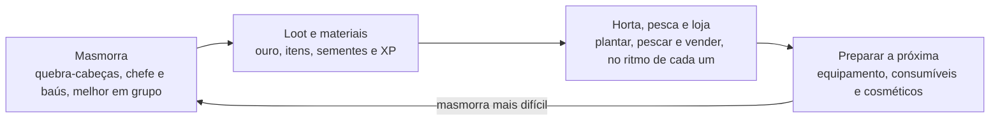

# Ideias para evoluir o jogo

O jogo deve crescer em profundidade, não em quantidade de sistemas: mais aventura com as peças que já existem,
e só as mecânicas novas que se conectam ao resto. Mossblade é um Zelda-like para jogar com amigos.
O diferencial é explorar, lutar e resolver quebra-cabeças juntos.

## Critério para uma mecânica nova

Uma mecânica nova só entra se responder "sim" a pelo menos três destas perguntas:

1. **Alimenta algo que já existe?** Usa o ouro, o inventário e os itens atuais, sem moeda, menu ou progressão próprios.
2. **Dá para entender em 10 segundos, sem tutorial?**
3. **É mais legal com amigos?** Se cada um faz sozinho no seu canto, enfraquece o diferencial.
4. **Dá vontade, e não obrigação?** Se o jogador sente que precisa fazer para não ficar para trás, virou tarefa.

Toda mecânica nova entra atrás de uma chave no `config.yaml`, como `fun.liftPlayers`.
Se não ficar divertida, desliga sem custo.

## O que já existe

O jogo já tem as peças de uma aventura completa; o que falta é juntá-las em conteúdo.

| Mecânica | Papel no ciclo | Observação |
| --- | --- | --- |
| Espada, arco, bombas | Aventura | Base do combate |
| Magias (fogo, luz, sombra) | Aventura | Gastam mana; vendidas pela Rosa ou do Rei Geleca |
| Blocos, placas, tochas, paredes rachadas e ilusórias | Aventura | Peças prontas para quebra-cabeças de masmorra |
| Baús, portais, chefe (Rei Geleca) | Aventura | Estrutura de masmorra já existe |
| Loot, XP e níveis | Recompensa | Liga a aventura ao resto |
| Loja da Rosa (compra e venda) | Economia | Único destino do ouro hoje |
| Pesca | Calma | Rende itens para vender |
| Invasão | Evento em grupo | Bom motivo para juntar todo mundo |
| PvP opcional, zonas seguras | Social | Ligado por jogador |
| Dia e noite | Ambiente | Muda monstros e iluminação |
| Levantar e arremessar amigos, galinhas | Diversão | Brincadeira social, não progressão |
| Chat (Perto e Todos) | Social | |

O que falta: um destino para o ouro além da loja, e um motivo para voltar ao jogo entre uma sessão e outra.

## O ciclo do jogo

A masmorra é a aventura; horta, pesca e loja são o que se faz com calma entre uma aventura e outra.
Cada sistema tem um papel nesse ciclo, e nenhum existe sozinho.

O que não se encaixa em nenhuma etapa deste ciclo merece uma segunda olhada antes de entrar no jogo.

## Ideias prioritárias

Três ideias, nesta ordem. A masmorra vem primeiro porque é conteúdo novo feito com sistemas que já existem.

### 1. Masmorras

É o coração de um Zelda-like e quase não exige sistema novo.

- **Escopo mínimo:** uma masmorra curta, de 6 a 10 salas, num mapa próprio ligado por portal. Cada sala ensina
  ou combina uma peça: bloco na placa, tocha que abre portão, parede rachada para bomba, parede ilusória revelada pela luz.
- **Em grupo:** salas que pedem duas pessoas (uma segura a placa, a outra passa) e salas que ficam mais rápidas
  em grupo, mas não bloqueiam quem joga sozinho.
- **Recompensa:** um chefe no fim e um item de exploração que muda o jeito de jogar e abre partes do Vale
  (ver "O que falta comparado ao Zelda").
- **Sistemas novos necessários:** chaves pequenas e porta trancada, e o item de exploração.
- **Depois:** uma masmorra nova a cada fase, cada uma com um tema (fogo, água, sombra) que valoriza uma magia.

### 2. Horta

Boa ideia se for pequena: plantar, esperar no tempo real e colher.

- **Como funciona:** sementes compradas na Rosa ou caídas de monstros. A planta cresce mesmo com o jogador offline,
  usando o relógio real que os baús já usam e a lógica do sistema de regeneração.
- **Ligada ao resto:** a colheita vende na loja ou vira consumível útil, como uma fruta que cura, para levar na masmorra.
- **Sem punição:** planta não morre por falta de cuidado. Regar pode acelerar, nunca ser obrigatório.
- **Fora do escopo:** adubo, qualidade de colheita, estações, pragas.

#### Onde fica a horta: fazenda particular, como no Albion Online

No Albion, cada jogador tem uma ilha particular: uma instância só dele, onde planta e constrói, e onde pode
deixar amigos entrarem. Isso encaixa bem aqui, porque o servidor já roda um `World` por mapa e o `transfer()`
já leva o jogador de um mundo para outro.

| Opção | Como é | A favor | Contra |
| --- | --- | --- | --- |
| **A. Fazenda instanciada** (Albion) | Mapa particular, entrada pela vila | Espaço próprio, dá para decorar e expandir | Isola; é a opção que dá mais trabalho |
| **B. Lote na vila** | Canteiros com dono no mapa principal | Todo mundo vê a fazenda de todo mundo; mais simples | Espaço limitado; menos sensação de "minha casa" |
| **C. Híbrido** | Instanciada, mas as portas ficam lado a lado na vila e amigos podem visitar e ajudar | Espaço próprio sem perder o social | Um pouco mais de trabalho que a A |

**Escolha sugerida: C.** Fazenda só instanciada isola o jogador, e o jogo é sobre jogar junto.
A rua de portas na vila mostra quem está em casa e convida a visitar.

Como seria no código:

- **Mapa modelo:** um `fazenda.tmj` no Tiled; cada fazenda é uma cópia dele, com id próprio (`fazenda:<id do personagem>`).
- **Carregar e descarregar:** o mundo da fazenda é criado quando alguém entra e salvo e descartado quando fica vazio,
  para fazendas sem ninguém não pesarem no servidor.
- **Crescer offline:** guarda a hora em que plantou e calcula o estágio ao carregar, com o relógio real
  (`world.now`, como os baús). Nada é simulado enquanto a fazenda está fechada.
- **Banco:** tabela nova `farms` (personagem, canteiros em JSON, data de atualização), no estilo de `characters`.
- **Entrada:** porta ou NPC na vila com "Ir para minha fazenda". Os portais hoje têm destino fixo; este precisa
  de destino dinâmico, e o `checkPortals` precisa aceitar isso.

Em duas etapas:

1. **Fazenda própria:** porta na vila, mapa modelo, plantar, crescer offline, colher e vender na Rosa.
2. **Visitas:** entrar na fazenda de um amigo (todos ou só quem o dono permitir) e ajudar a regar ou colher.

Decoração, construções e animais só depois, se a horta pegar com o grupo.

### 3. Troca entre jogadores

Só se o grupo pedir, e na forma mais simples.

- **Primeiro passo:** troca direta. Os dois põem itens e ouro numa janela e confirmam; o servidor faz a troca
  de uma vez só, sem chance de duplicar item.
- **Fora do escopo por enquanto:** casa de leilão e mercado global. Fazem sentido com muita gente, e trazem
  inflação, bugs de duplicação e muita interface.
- **Vender o que produziu:** já resolvido pela loja da Rosa; basta adicionar os itens da horta no `sell` do config.

## O que falta comparado ao Zelda

A base de Zelda já está aqui: espada com giro, arco, bombas, dash, pulo de barranco, levantar e arremessar,
arbustos, blocos e placas, tochas, paredes rachadas e ilusórias, portões, baús, chefe, NPCs, loja, pesca,
dia e noite. O que falta não é mecânica solta, e sim as estruturas que dão a sensação de aventura Zelda.

### 1. Itens que abrem o mundo

Num Zelda, cada item novo é uma chave: o jogador vê um lugar inalcançável cedo e volta quando consegue chegar.
O começo disso já existe (bomba abre parede rachada, fogo acende tocha, luz revela parede ilusória), mas esses
itens vêm da loja, não de uma conquista.

- **Itens de exploração**, não de combate: gancho, bumerangue (pega item longe, aperta botão distante),
  nadadeiras, luva para pedra pesada, lanterna para caverna escura.
- **Cada masmorra dá um desses itens**, usado no chefe e depois no mapa aberto.
- **Lugares visíveis e inalcançáveis** espalhados pelo Vale desde o começo.

### 2. Estrutura de masmorra

- **Chaves pequenas e portas trancadas**, e uma chave grande para a sala do chefe.
- **Mapa e bússola da masmorra**, encontrados lá dentro.
- **Minichefe** no meio, que costuma guardar o item da masmorra.
- **Salas que trancam até derrotar todos os monstros**: simples e dá ritmo.

### 3. Vida que cresce por exploração

Hoje a vida cresce por nível e XP. No Zelda, cresce com **corações extras** (um por chefe) e **pedaços de coração**
escondidos (4 formam um coração). É a melhor recompensa para segredos: quem explora fica mais forte.
Dá para manter o XP e somar isso, ou trocar o ganho de vida por nível pelos corações.

### 4. Combate com mais variedade

Hoje são 4 tipos de monstro além do chefe (geleca, besouro, morcego, galinha) e não há escudo.
No Zelda, cada inimigo pede uma tática:

- **Escudo** que bloqueia projéteis, e um inimigo que atira pedras.
- Inimigo que **só leva dano por trás** ou depois de atordoado.
- Inimigo que **só morre com um item**, como o bumerangue ou o fogo.
- Cada inimigo novo deve ensinar algo, não só ter mais vida.

### 5. Mundo e navegação

- **Mapa do mundo** e minimapa.
- **Viagem rápida** entre pontos já visitados (o papel da ocarina).
- **Fonte de fadas** que cura tudo, como recompensa de segredo.
- **Mais mapas**: hoje são o Vale e a Caverna.

### 6. Propósito e história

- Uma **premissa**: por que o herói está no Vale e o que ameaça o lugar.
- **NPCs com pedidos**: missões curtas e uma cadeia de trocas (um item que leva a outro).
- O **momento "Você conseguiu!"**, com o item erguido e a música, ao ganhar algo importante.

As partes 1, 2 e 3 andam juntas e entram na primeira masmorra do roteiro: chaves, minichefe, um item de
exploração (o gancho, por exemplo) que também abre partes do Vale, e pedaços de coração escondidos pelo mapa.

## Ideias menores

Ideias pequenas que aproveitam o que já existe. Nenhuma pede um sistema novo para o jogador aprender.

| Ideia | O que reaproveita | Por que vale |
| --- | --- | --- |
| Receitas simples: peixe ou fruta + fogo vira comida que cura | Pesca, horta, Cajado de Fogo | Liga a calma à aventura sem menu de crafting |
| Pedidos da vila: um NPC pede "5 peixes" e paga em ouro | NPCs, inventário, loja | Dá objetivo curto para quem entra por 15 minutos |
| Recordes da masmorra (menor tempo, sem dano) | `records` do servidor | Competição amigável entre amigos |
| Cosméticos compráveis (capas, cabelos, chapéus) | Aparência (`looks`) | Destino para o ouro que não desequilibra nada |
| Casa ou canteiro decorável na vila | Horta, cosméticos | Lugar para mostrar o que conquistou |
| Segredos no mapa: parede ilusória com baú raro | Paredes, baús, luz | Recompensa quem explora |
| Eventos noturnos especiais | Dia e noite, invasão | Motivo para jogar junto num horário |
| Emotes e sentar ao redor da fogueira | Chat, tochas | Momentos sociais sem regra nenhuma |

Cosméticos são o melhor destino para o ouro, porque não criam vantagem e não exigem balanceamento.

## Melhorias de uso: inventário

O inventário funciona, mas é pouco prático no dia a dia, no PC e no celular. Quanto mais itens entrarem
(horta, receitas, masmorras), pior fica. Melhorar isso antes da horta evita que cada item novo vire incômodo.

Como está hoje:

- Abrir o inventário (`I` ou botão) para o personagem, mas o mundo continua: abrir no meio de uma luta é perigoso.
- Atalhos `1`, `2` e `3` são fixos em coração, mana e bomba; o jogador não escolhe.
- Trocar a arma do A ou do C exige abrir o inventário e ciclar pelo botão `⟳`, uma de cada vez.
- 20 espaços numa grade única, sem ordem nem categorias: equipamento, consumíveis e materiais se misturam.
- Usar: selecionar e apertar "Usar", ou dois cliques (no celular, dois toques não é natural).

Ideias, da mais importante para a menos:

1. **Barra rápida configurável:** 3 ou 4 espaços sempre na tela, no HUD do PC e no controle de toque do celular.
   O jogador escolhe o que vai em cada um (arrastar o item no PC, segurar o item e escolher o espaço no celular).
   Teclas `1` a `4` usam. Resolve a maior parte do uso diário sem abrir o inventário.
2. **Troca rápida de arma sem abrir nada:** segurar o botão A ou C abre uma roda com as armas que o jogador tem;
   solta em cima da escolhida. O mundo fica em câmera lenta enquanto a roda está aberta, como em Zelda.
   No celular, segurar o botão A ou C do controle de toque faz o mesmo.
3. **Ações perto do item:** tocar ou clicar num item abre um menu pequeno ao lado dele (Usar, Equipar no A,
   Equipar no C, Pôr na barra, Largar), em vez de botões fixos embaixo do painel. Mais natural no celular.
4. **Organização automática:** o inventário se ordena sozinho por tipo (equipamento, consumíveis, materiais),
   com um separador visual entre os grupos. Sem abas e sem arrastar para organizar.
5. **Equipamento fora dos espaços:** armas e cajados ficam numa fileira própria no topo do painel e não ocupam
   os 20 espaços. A mochila fica para o que se gasta e o que se vende.
6. **Venda em lote na loja:** "Vender todos os materiais" na Rosa, com o total antes de confirmar.
   Essencial quando a horta e a pesca estiverem rendendo.
7. **Baú na fazenda:** um baú de guardar itens na fazenda particular (ver Horta), para a mochila não ser o único lugar.

Fora do escopo: peso, durabilidade, limite de espaços por categoria, crafting dentro do inventário.

### Pegar e receber itens

Hoje o item é pego passando por cima: às vezes pega sem querer, enche a mochila no meio da briga e não dá para deixar
algo no chão para um amigo. A ideia é que o botão de **Ação (B)** pegue e abra as coisas, e que o que se ganha vá para a mochila.

**Direção definida:**

- **Item no chão é pego com o botão.** Chegando perto, o botão de ação mostra "Pegar" (no celular, o botão B muda de nome,
  como já faz com "Arremessar" e "Puxar"). Com vários itens perto, pega o mais próximo; segurar o botão pega tudo em volta.
- **Baú: abrir e receber tudo na mochila.** Duas regras possíveis para quando falta espaço:

  | Regra | Como fica |
  | --- | --- |
  | A. Tudo ou nada (proposta original) | sem espaço para tudo, o baú não abre e avisa "Mochila cheia: libere 3 espaços"; faz o jogador planejar a mochila antes de abrir um baú único |
  | B. O baú guarda o resto | recebe o que cabe; o resto fica no baú esperando; ninguém precisa voltar só por um item |

**Sugestão, a decidir:** o ouro vai direto para a carteira de quem derrubou o monstro, sem cair no chão, porque não ocupa
espaço e apertar botão para cada moeda cansa.

**Em estudo: o drop de monstro.** Ainda não é uma decisão final. As opções:

| Opção | Como fica | A favor | Contra |
| --- | --- | --- | --- |
| No chão (como hoje, estilo Zelda) | os itens se espalham perto do monstro e são pegos com o botão | rápido, combina com o combate de ação | com muitos monstros, o chão fica cheio de itens |
| Dentro da criatura (estilo Tibia) | o monstro derrubado vira um corpo; abrir manda o loot para a mochila | chão limpo, o "abrir para ver o que veio" | num grupo de 10 gelecas, 10 corpos para abrir um a um; mais lento |
| Saquinho de loot (meio-termo) | o monstro deixa um saquinho, com a cor da raridade do melhor item dentro; abrir funciona como o baú | uma interação só para baú e drop; chão limpo; brilha quando é bom | um objeto a mais no mundo; precisa testar se não fica repetitivo |

Em qualquer opção: o loot fica reservado para quem derrubou por alguns segundos (como hoje), e no chefe cada um que
bateu ganha o próprio loot (como no Rei Geleca). Vale testar as opções com o grupo antes de decidir.

## Mais ideias para jogar junto

Ideias que puxam para o diferencial do jogo: jogar junto. As marcadas com ★ são as mais valiosas.
Ferramentas de criação de conteúdo (itens, monstros, NPCs, magias) ficam em `docs/OFICINA.md`.

### Jogar junto

- ★ **Levantar amigo caído:** quem cai fica no chão alguns segundos antes de renascer na Clareira. Um amigo que segura
  o botão de Ação em cima dele o levanta ali mesmo, com metade da vida. A morte vira momento de grupo e o curandeiro ganha papel.
- ★ **Grupo (party):** convidar amigos para um grupo. Vida dos outros no HUD, uma seta na borda da tela apontando para
  cada amigo, XP e loot divididos. É a base que as masmorras instanciadas pedem.
- **Marcar no mapa:** uma tecla (ou um toque no mapa) põe um marcador "venham aqui!" que o grupo vê.
- **Lista de amigos:** quem está online e em que região, com "ir até ele" (ou a viagem rápida, quando existir).

### Brincadeiras sem regra

- ★ **Minijogos na Clareira**, com peças que já existem: futebol com uma bomba falsa (chuta com a espada), corrida pelo Vale
  com tempo no placar, pique-pega (quem é pego fica lento), "rei da colina" numa arena de PvP com placar.
- **Bichinho de estimação:** uma galinha ou uma geleca filhote que segue o jogador, só enfeite. Destino para o ouro, junto com os cosméticos.
- **Modo foto:** esconde o HUD e os nomes para tirar print do grupo na fogueira.

### O mundo mais vivo

- **Clima:** chuva que apaga tochas e enfraquece o fogo; neblina na caverna. Combina com o dia e noite e com as magias de fogo e luz.
- **Música por região:** calma na Clareira, tensa na caverna, de chefe quando o Rei Geleca acorda.
- **Eventos de temporada:** Halloween, Natal, aniversário do servidor, montados como pacotes na Oficina e reaproveitados todo ano.

### O app e a comunidade

- ★ **Notificações no app Android:** "A invasão começa em 10 minutos!", "Joel entrou no jogo", "Sua plantação está pronta".
  Traz a galera de volta sem ninguém precisar chamar no WhatsApp.
- **Moderação básica:** filtro de palavrões (desligável), silenciar um jogador, denunciar. Com 100 pessoas, alguém vai passar do ponto.
- **Primeiros minutos guiados:** o Velho Tomé dá uma primeira missão curta que ensina andar, atacar, pegar item e falar
  com a Rosa. Hoje quem chega precisa descobrir sozinho.

### Cuidado com o jogador

- **Acessibilidade:** ícone além da cor na raridade (daltonismo), tamanho de texto ajustável, teclas e botões do controle remapeáveis.

**Para começar:** levantar amigo caído, grupo e notificações no app. As duas primeiras deixam o jogo mais social na hora
e preparam a masmorra; a terceira resolve o "como juntar a galera num horário".

## O que evitar

O que estraga um jogo assim é sistema isolado e obrigação disfarçada de conteúdo.

- **Moedas e progressões paralelas:** "pontos de fazenda", "reputação de pesca", nível de profissão.
  Cada uma é mais uma barra para o jogador acompanhar.
- **Manutenção punitiva:** planta que morre, comida que estraga, equipamento que quebra. Transforma diversão em tarefa.
- **Tarefas diárias obrigatórias:** quem perde um dia sente que ficou para trás. Recompensa por voltar é bônus, nunca perda.
- **Crafting com dezenas de materiais:** inventário cheio de coisas que o jogador não sabe para que servem.
- **Mecânicas que separam o grupo:** atividades que só dá para fazer sozinho, ou que fazem um amigo esperar o outro.
- **Mais um sistema antes de terminar o anterior:** cada mecânica nova só entra depois que a anterior foi jogada com os amigos.

## Roteiro e playtest

Cada etapa termina com uma sessão de jogo com os amigos; a próxima só começa se a anterior ficou divertida.

1. **Primeira masmorra completa:** 6 a 10 salas, chaves, minichefe, chefe e um item de exploração.
   Junto, alguns pedaços de coração escondidos no Vale.
2. **Fazenda particular mínima:** porta na vila, plantar, esperar, colher e vender. Uma ou duas culturas.
   Visitas de amigos logo em seguida.
3. **Receita simples e pedidos da vila:** ligam horta e pesca à masmorra.
4. **Cosméticos na loja:** dão destino ao ouro.
5. **Troca direta entre jogadores:** só se o grupo pedir.
6. **Segunda masmorra**, com tema próprio.

O que observar em cada sessão:

- [ ] O que os amigos fazem sem ninguém mandar?
- [ ] O que eles ignoram ou abandonam depois de testar uma vez?
- [ ] Alguém perguntou "como faz isso?" mais de uma vez? Se sim, simplificar.
- [ ] Alguém ficou esperando o outro sem nada para fazer?
- [ ] Quanto tempo a sessão durou, e quem quis jogar de novo no dia seguinte?

Se uma mecânica ninguém usa, desliga no config. Tirar também é evoluir o jogo.
